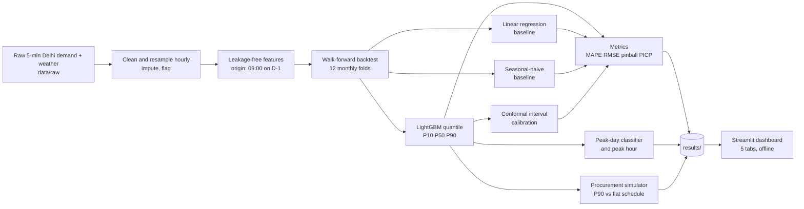

# Peak-Aware Load Forecasting & Procurement Copilot for Delhi's DISCOM

**CodeSpark 2026 | 12-Hour National Hackathon | Domain: Renewable and Sustainable Energy | Team SixSense**

> Delhi's demand swings from about 2,000 MW in winter to over 8,000 MW in summer. A single-number forecast hides the real risk: **how bad can the peak get, and which hours are at risk?** We forecast demand as a *range*, flag the days that will peak, and turn that range into a **day-ahead buy schedule with a rupee cost**.

---

## What it does

| Capability | Output |
|---|---|
| **Probabilistic forecasts** | Hourly P10 / P50 / P90 for **day-ahead (24 h)** and **week-ahead (168 h)** |
| **Peak-event classifier** | Will today's peak be in the top 10% of days, and at which hour? Scored with precision, recall and F1 |
| **Procurement advisor** | Converts the P90 forecast into a buy schedule and compares its cost with a flat schedule under a transparent tariff / DSM model |
| **Honest evaluation** | Walk-forward backtest, two baselines, interval coverage (PICP), peak-specific errors and a missed-peak drill-down |
| **Operational dashboard** | Five-tab Streamlit app that reads saved result files only, so the demo works offline |

---

## Quick start

```bash
# 1. Install dependencies
pip install -r requirements.txt

# 2. Download the raw 5-minute Kaggle dataset into data/raw/
python data/download_raw.py

# 3. Run the full pipeline (12-fold walk-forward backtest + peaks + procurement)
python pipeline.py data/raw

# 4. Unit-test the procurement cost model
python procurement/test_procurement.py

# 5. Launch the dashboard
streamlit run app.py
```

Quick smoke test: `python pipeline.py data/raw --folds 3`

`pipeline.py` and `app.py` at the repository root are the **source of truth**. Everything in `results/` and `docs/` is generated from them.

---

## How it works



### Data
- **Source:** Kaggle *Delhi 5-Minute Electricity Demand for Forecasting* (2021-2024, with weather).
- **Used columns:** `datetime`, `Power demand` (target, MW), `temp`, `rhum`. Demand is averaged to hourly.
- **Deliberately excluded:** `moving_avg_3` (leaks the target) and the pre-split `year/month/day/hour/minute` columns (calendar features are rebuilt).
- **Cleaning:** readings below 500 MW treated as sensor errors; gaps up to 6 hours interpolated; longer gaps filled with the same hour one week earlier; every filled hour is **flagged and excluded from scoring**.

### Features
| Group | Features |
|---|---|
| Calendar | hour, day of week, month, weekend flag, trend |
| Events | distance to Holi / Diwali / Eid, festival window, 2021 lockdown flag |
| Load history | day-ahead: 48 h and 168 h lags, 7-day rolling mean. Week-ahead: 336 h and 504 h lags |
| Cooling load | cooling-degree-hours (base 25 C) and its 24 h rolling sum |
| Thermal inertia | temperature lags at 24 / 48 / 72 h, 72 h rolling mean |
| Heat stress | heat index (Rothfusz regression), relative humidity |

**Leakage rule:** every feature uses only data available at **09:00 on the day before** the forecast day. Week-ahead drops the 168 h lag because it would reach past that moment. Weather is the one exception (see Limitations).

### Models
| Model | Role |
|---|---|
| LightGBM quantile regression (alpha 0.1 / 0.5 / 0.9) | Main model; quantiles are sorted so they never cross |
| LightGBM + conformal interval adjustment | Calibrated variant, reported **side by side** with the raw model |
| Linear regression | Baseline |
| Seasonal-naive (same hour last week) | Baseline |
| LightGBM classifier | Peak-day detector; peak hour from the P50 forecast |

If LightGBM is unavailable, the code falls back to scikit-learn gradient boosting and CSV outputs.

### Evaluation protocol
- **Walk-forward only:** expanding training window, monthly test blocks across the last 12 months, models retrained every fold. **No random splits anywhere.**
- **Metrics:** MAPE, RMSE, pinball loss, **PICP** (share of actuals inside the P10-P90 band, expected near 80%), peak precision / recall / F1, peak-timing error and peak-magnitude error.
- **Peak day:** daily maximum above the 90th percentile of daily maxima in the training window.

### Procurement model
Buy the P90 forecast each hour and compare against a flat schedule.

```
cost = scheduled_kWh x contracted_rate
     + shortfall_kWh x DSM_rate
     + surplus_kWh   x stranded_rate
```

Rates (Rs 5.00, Rs 12.00 and Rs 2.50 per kWh) are **placeholder assumptions, not DERC tariffs**. A sensitivity grid shows how the saving changes across a range of rates, and unit tests cover the cost function.

---

## Results

Final numbers are generated by the pipeline and **are never hand-edited**.

| File | Contents |
|---|---|
| `results/accuracy_table.csv` | MAPE, RMSE, pinball, PICP per model and horizon, with improvement over baseline |
| `results/peak_summary.csv` | Peak precision, recall, F1, timing and magnitude error |
| `results/missed_peaks.csv` | Every day the actual peak beat the P90 forecast or the peak flag was missed |
| `results/procurement_week.json` | Sample-week costs, risk exposure and sensitivity grid |

<!-- PASTE FINAL TABLE HERE after the last pipeline run: copy results/accuracy_table.csv as a markdown table -->

---

## Dashboard

| Tab | What judges see |
|---|---|
| **Forecast** | Actual vs P50 with the shaded P10-P90 band and peak markers |
| **Accuracy vs baselines** | Per-horizon metrics against seasonal-naive and linear regression |
| **Error heatmap** | Error by hour of day and season |
| **Missed peaks** | Table plus a day-level drill-down chart with the likely reason |
| **Procurement** | P90 vs flat cost, saving, risk exposure and tariff sensitivity |

---

## Repository layout

```
pipeline.py            # master pipeline (source of truth)
app.py                 # 5-tab Streamlit dashboard (reads results/ only)
ARCHITECTURE.md        # system design and data contracts
data/
  download_raw.py      # Kaggle download into data/raw (git-ignored)
  build_dataset.py     # earlier modular data builder (kept)
features/ eval/ models/ procurement/ app/
                       # earlier modular implementations by teammates (kept);
                       # procurement/ is the cost-model source used by the pipeline
scripts/               # raw-data inspection and sanity checks
results/               # generated forecasts, metrics, peaks, procurement
docs/                  # model card, procurement memo, peaks write-up, pitch, assumptions
```

### Output contracts
- `results/forecasts_{day,week}.csv`: `ts, fold, horizon, model, p10, p50, p90, actual`
- `results/peak_flags.csv`: peak probability, predicted and actual peak flag and hour, threshold, peak magnitudes
- `results/procurement_week.{json,csv}`: schedule, costs, risk exposure, sensitivity grid

---

## Documentation

- [ARCHITECTURE.md](ARCHITECTURE.md): system design, data contracts, design decisions
- [docs/model_card.md](docs/model_card.md): data card, metrics, limitations, failure modes
- [docs/procurement_memo.md](docs/procurement_memo.md): sample-week procurement memo
- [docs/why_peaks_are_hard.md](docs/why_peaks_are_hard.md): weather sensitivity, festivals, thermal inertia, with evidence from `missed_peaks.csv`
- [docs/assumptions.md](docs/assumptions.md): locked assumptions
- [docs/pitch_outline.md](docs/pitch_outline.md): 3-minute pitch and Q&A

---

## Limitations and honesty notes

- **Weather is a proxy.** Models use observed weather in place of archived forecast weather, so reported accuracy is optimistic compared with real deployment.
- **Intervals need calibration.** Raw quantile bands can under-cover; the calibrated variant is reported next to the raw one, never instead of it.
- **Peak timing is hourly.** The pipeline works at hourly resolution, so timing errors move in 60-minute steps.
- **Hand-entered dates.** Holi, Diwali and Eid dates and the 2021 lockdown window are entered manually; verify them before reuse.
- **Placeholder tariffs.** Procurement savings depend entirely on the assumed rates and are **simulated, not actual DISCOM costs**.
- **Abrupt regimes.** Sudden heatwave onsets and cold snaps are hardest to capture under the 09:00 D-1 lag constraint.

---

## Roadmap

1. Replace actual-weather proxy with archived NWP forecasts (for example Open-Meteo historical forecasts).
2. Add Prophet and an LSTM / Temporal Fusion Transformer comparison and a stacked ensemble.
3. Move to 15-minute resolution for minute-level peak timing.
4. Load real DERC tariff and DSM penalty schedules into the procurement model.
5. Add odd-even and event flags from an official calendar.

---

## Credits

- Dataset: Kaggle, *Delhi 5-Minute Electricity Demand for Forecasting* (user `yug201`). Check the dataset page for licence terms.
- Built at CodeSpark 2026, Department of CSE (Data Science), AMC Engineering College.
- Team SixSense
